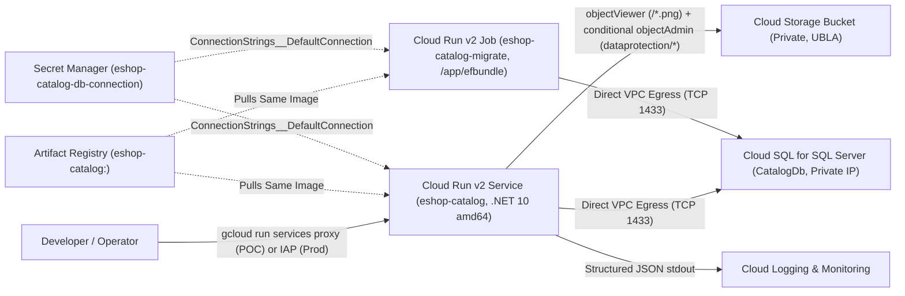

# Walkthrough: `eShopLegacyMVC` Modernization to .NET 10 on Google Cloud Run

## Overview

`eShopLegacyMVCSolution` has been modernized on branch `poc/antigravity-cloudrun` into a **single, stateless ASP.NET Core (`.NET 10`) `linux/amd64` container service** targeting **Google Cloud Run** (`australia-southeast1`, project `chintan-sandbox`), backed by **Cloud SQL for SQL Server** (Private IP), **Google Cloud Storage** (catalog product images and ASP.NET Core Data Protection keys), **Secret Manager** (database connection string), **Artifact Registry**, and an **EF Core migration bundle Cloud Run Job** (`/app/efbundle`), all defined declaratively under `infra/`.

- **Base Project Choice**: Built on `eShopPorted` (which already had an SDK-style `.csproj`, EF Core `IEntityTypeConfiguration<T>` classes, unbundled Razor views, and `wwwroot/` layout), backported the missing legacy routes (`GET /api/brands/{id}`, `GET /api`, and `PicController` route generation), and removed `src/eShopLegacyMVC` from [eShopLegacyMVC.sln](../../eShopLegacyMVCSolution/eShopLegacyMVC.sln) while keeping `eShopLegacyMVCSolution/src/eShopLegacyMVC/` **100% untouched on disk** as the historical reference.
- **No Cloud Mutations Executed**: Per [SKILL.md](../../.agents/skills/mh-modernize/SKILL.md), neither `terraform apply` nor `gcloud run deploy` was executed.



---

## Summary of Changes by Commit (`poc/antigravity-cloudrun`)

| Commit | Phase / Finding | Summary of Changes | Key Files |
| :--- | :--- | :--- | :--- |
| `19ef6e2` | Phase 1 — **P0 / SEC-01** | Upgraded `eShopLegacy.Utilities` from `.NET Framework 4.6.1` to SDK-style `net10.0`; replaced `BinaryFormatter` with `System.Text.Json`; updated `FilesController` (`GET /api/files`) to stream UTF-8 JSON (`application/json`). | [eShopLegacy.Utilities.csproj](../../eShopLegacyMVCSolution/eShopLegacy.Utilities/eShopLegacy.Utilities.csproj), [Serializing.cs](../../eShopLegacyMVCSolution/eShopLegacy.Utilities/Serializing.cs), [FilesController.cs](../../eShopLegacyMVCSolution/eShopPorted/Controllers/Api/FilesController.cs) |
| `8b885c5` | Phase 1 — **P0 / P2 / SEC-05** | Upgraded `eShopPorted` from `net461` (ASP.NET Core 2.2 / EF Core 2.2.6) to `net10.0` (EF Core `10.0.15`); removed `src/eShopLegacyMVC` from `.sln` only; removed `System.Web`, `Autofac`, `WebGrease`, `Antlr`, `Startup.cs`, `app.config`, and `Views/Web.config`; ported `PicController` to `Microsoft.AspNetCore.Mvc`; added `/healthz`, `/Catalog/Error`, `GET /api`, and `GET /api/brands/{id}`. | [eShopLegacyMVC.sln](../../eShopLegacyMVCSolution/eShopLegacyMVC.sln), [eShopPorted.csproj](../../eShopLegacyMVCSolution/eShopPorted/eShopPorted.csproj), [Program.cs](../../eShopLegacyMVCSolution/eShopPorted/Program.cs), [PicController.cs](../../eShopLegacyMVCSolution/eShopPorted/Controllers/PicController.cs), [BrandsController.cs](../../eShopLegacyMVCSolution/eShopPorted/Controllers/Api/BrandsController.cs) |
| `e6efc44` | Phase 1 — **Linux Casing** | Renamed `eShopPorted/wwwroot/Images/` to `eShopPorted/wwwroot/images/` so `_Layout.cshtml` (`~/images/...`) and `Site.css` (`../images/main_banner.png`) resolve on case-sensitive Linux filesystems. | `eShopPorted/wwwroot/images/*` |
| `c20b730` | Phase 1 — **SEC-05** | Upgraded CDN client libraries (`Bootstrap 4.6.2`, `jQuery 3.7.1`, `Popper 1.16.1`, `jQuery Validate 1.21.0` with verified SHA-384 SRI hashes) and removed unused legacy JS/CSS copies from `eShopPorted/wwwroot/`. | [_Layout.cshtml](../../eShopLegacyMVCSolution/eShopPorted/Views/Shared/_Layout.cshtml), [Create.cshtml](../../eShopLegacyMVCSolution/eShopPorted/Views/Catalog/Create.cshtml), [Edit.cshtml](../../eShopLegacyMVCSolution/eShopPorted/Views/Catalog/Edit.cshtml) |
| `1fafeb2` | Phase 1 — **P0 / P2 / SEC-07** | Removed LocalDB connection string; added fail-fast connection check and SQL Server `EnableRetryOnFailure`; configured `decimal(18,2)` precision on `Price` and native EF Core 10 `UseHiLo` sequences (`catalog_hilo`, `catalog_brand_hilo`, `catalog_type_hilo` starting at `100` past seed IDs `1..12`); regenerated EF Core `10.0.15` `InitialCreate` migration. | [CatalogDBContext.cs](../../eShopLegacyMVCSolution/eShopPorted/Models/CatalogDBContext.cs), [CatalogItemConfig.cs](../../eShopLegacyMVCSolution/eShopPorted/Models/Config/CatalogItemConfig.cs), [20261125000804_InitialCreate.cs](../../eShopLegacyMVCSolution/eShopPorted/Migrations/20261125000804_InitialCreate.cs), [appsettings.json](../../eShopLegacyMVCSolution/eShopPorted/appsettings.json) |
| `50d4459` | Phase 1 — **P1 / SEC-03** | Added `ICatalogImageStorage` (`GcsCatalogImageStorage` via `Google.Cloud.Storage.V1` when `Storage:BucketName` is set, plus path-traversal-hardened `LocalCatalogImageStorage` fallback); removed `PictureFileName` from `[Bind(...)]` on `Create`/`Edit` to block form-tampering traversal payloads. | [ICatalogImageStorage.cs](../../eShopLegacyMVCSolution/eShopPorted/Services/ICatalogImageStorage.cs), [CatalogImageStorage.cs](../../eShopLegacyMVCSolution/eShopPorted/Services/CatalogImageStorage.cs), [CatalogItem.cs](../../eShopLegacyMVCSolution/eShopPorted/Models/CatalogItem.cs) |
| `7390d0a` | Phase 1 — **P1 (Async I/O)** | Converted `ICatalogService`, `CatalogService` (`AsNoTracking`, `ToListAsync`, `LongCountAsync`, `SaveChangesAsync`), thread-safe `CatalogServiceMock` (`Lock` + cloned entities), and all 4 controllers to async `Task` pipelines with `CancellationToken`. | [ICatalogService.cs](../../eShopLegacyMVCSolution/eShopPorted/Services/ICatalogService.cs), [CatalogService.cs](../../eShopLegacyMVCSolution/eShopPorted/Services/CatalogService.cs), [CatalogServiceMock.cs](../../eShopLegacyMVCSolution/eShopPorted/Services/CatalogServiceMock.cs), [CatalogController.cs](../../eShopLegacyMVCSolution/eShopPorted/Controllers/CatalogController.cs) |
| `1c1c58e` | Phase 1 — **P1 / P3 / SEC-06** | Removed `log4net`; injected `ILogger<T>` backed by `AddJsonConsole()` for Cloud Logging; disabled Kestrel `Server` header; stripped `@Environment.MachineName` and startup timestamp from `_Layout.cshtml`. | [Program.cs](../../eShopLegacyMVCSolution/eShopPorted/Program.cs), [_Layout.cshtml](../../eShopLegacyMVCSolution/eShopPorted/Views/Shared/_Layout.cshtml) |
| `bfe2920` | Phase 1 — **SEC-04** | Updated `Convert-ToPackageReference.ps1` to default to the local vendored `Convert-ToPackageReference.xsl`, block `http(s)://` URIs, verify SHA-256 (`92E311E0...`), and disable `XsltSettings` scripts/DTDs. | [Convert-ToPackageReference.ps1](../../eShopLegacyMVCSolution/Convert-ToPackageReference.ps1) |
| `c88d7e4` | Phase 1 — **SEC-02** | Added `CloudRunIamAuthenticationHandler` and enforced `[Authorize(Policy = "CatalogWrite")]` across `CatalogController` (`Create`, `Edit`, `Delete`, `DeleteConfirmed`) and `BrandsController.Delete` (fail-closed `401` by default when `TrustCloudRunIam=false`). | [CloudRunIamAuthenticationHandler.cs](../../eShopLegacyMVCSolution/eShopPorted/Services/CloudRunIamAuthenticationHandler.cs), [CatalogController.cs](../../eShopLegacyMVCSolution/eShopPorted/Controllers/CatalogController.cs), [BrandsController.cs](../../eShopLegacyMVCSolution/eShopPorted/Controllers/Api/BrandsController.cs) |
| `178324c` | Phase 2 — **Container** | Added multi-stage Linux `Dockerfile` (including `/app/efbundle`), `.dockerignore`, and three runtime refinements detailed below. | [Dockerfile](../../eShopLegacyMVCSolution/Dockerfile), [.dockerignore](../../eShopLegacyMVCSolution/.dockerignore), [CatalogDBContext.cs](../../eShopLegacyMVCSolution/eShopPorted/Models/CatalogDBContext.cs) |
| `1a3f4de` | Phase 2 — **amd64 Pin** | Pinned `--platform=linux/amd64` on both `FROM` stages for Cloud Run compatibility and pinned `dotnet-ef` to `10.0.15`. | [Dockerfile](../../eShopLegacyMVCSolution/Dockerfile) |
| `83b071e` | Phase 3 — **Infra** | Added Terraform under `infra/` for VPC/PSA, Artifact Registry, private GCS bucket + seeded PNGs, Cloud SQL for SQL Server (`random_password`), Secret Manager, least-privilege SA, Cloud Run migration job, Cloud Run service, `invoker_members` validation, and `.terraform.lock.hcl`. | [versions.tf](../../infra/versions.tf), [variables.tf](../../infra/variables.tf), [main.tf](../../infra/main.tf), [outputs.tf](../../infra/outputs.tf), [.terraform.lock.hcl](../../infra/.terraform.lock.hcl) |
| `93acacd` | Phase 3/4 — **Data Protection** | Added `Google.Cloud.AspNetCore.DataProtection.Storage` (`1.0.0-alpha04`) to persist ASP.NET Core Data Protection keys to `dataprotection/keys.xml` in GCS when `DataProtection:BucketName` is configured. | [eShopPorted.csproj](../../eShopLegacyMVCSolution/eShopPorted/eShopPorted.csproj), [Program.cs](../../eShopLegacyMVCSolution/eShopPorted/Program.cs), [appsettings.json](../../eShopLegacyMVCSolution/eShopPorted/appsettings.json) |
| `936ed9f` | Phase 3/4 — **Infra Hardening** | Made `image_tag` required (disallowing `"latest"`), documented/supported 2-stage Artifact Registry deploy, scoped `roles/storage.objectAdmin` via IAM Condition to `dataprotection/` prefix only, removed `roles/cloudsql.client`, and added `iam` + `cloudresourcemanager` APIs. | [variables.tf](../../infra/variables.tf), [main.tf](../../infra/main.tf), [outputs.tf](../../infra/outputs.tf) |

### Key Container & Data Protection Details (`178324c`, `93acacd`, `936ed9f`)

1. **Antiforgery Scoped to `CatalogController` (`178324c`)**: Applying `AutoValidateAntiforgeryTokenAttribute` globally in `MvcOptions.Filters` caused stateless `[ApiController]` REST endpoints (`DELETE /api/brands/{id}`) to return `400 Bad Request` because programmatic API callers do not submit HTML form CSRF tokens. Moving `[AutoValidateAntiforgeryToken]` onto [CatalogController.cs](../../eShopLegacyMVCSolution/eShopPorted/Controllers/CatalogController.cs#L13) enforces CSRF tokens on all browser MVC mutations while keeping REST APIs functional.
2. **Cloud Run `PORT` Mapped via `http_ports` (`178324c`)**: Because the base image sets `ASPNETCORE_HTTP_PORTS=8080`, calling `UseUrls("http://0.0.0.0:8080")` when `PORT=8080` emitted a startup warning (`Overriding HTTP_PORTS '8080'`). Using `builder.WebHost.UseSetting("http_ports", port)` in [Program.cs](../../eShopLegacyMVCSolution/eShopPorted/Program.cs#L33) binds cleanly to any Cloud Run `PORT` without startup warnings.
3. **Design-Time Factory Reading `ConnectionStrings__DefaultConnection` (`178324c`)**: When `/app/efbundle` is invoked without CLI `--connection` arguments inside the `eshop-catalog-migrate` Cloud Run Job, EF Core instantiates `CatalogDBContextDesignFactory`. Reading `Environment.GetEnvironmentVariable("ConnectionStrings__DefaultConnection")` inside [CatalogDBContext.cs](../../eShopLegacyMVCSolution/eShopPorted/Models/CatalogDBContext.cs#L43-L45) allows the migration job to consume the Secret Manager environment mount directly without leaking credentials on the process command line.
4. **Prefix-Scoped Data Protection Key Persistence (`93acacd`, `936ed9f`)**: `PersistKeysToGoogleCloudStorage` writes the ASP.NET Core key ring to `dataprotection/keys.xml` in the catalog GCS bucket so antiforgery cookies remain valid across scale-to-zero restarts and multiple Cloud Run instances. In [main.tf](../../infra/main.tf#L222-L232), `roles/storage.objectAdmin` is restricted via an IAM Condition (`resource.name.startsWith("projects/_/buckets/<bucket>/objects/dataprotection/")`) so the runtime service account cannot overwrite or delete catalog product images at the bucket root.

---

## Report vs. Code Contradictions

Every finding in [eshop-legacy-mvc.md](./eshop-legacy-mvc.md) that the source code contradicted or overstated:

| # | Report Claim | Actual Code Reality | Resolution Taken |
| :--- | :--- | :--- | :--- |
| **1** | **SEC-01 (`BinaryFormatter` Critical Server-Side RCE)**: Claims `DeserializeBinary` exposes the server to Remote Code Execution (`CWE-502`). | `DeserializeBinary` in `Serializing.cs` was **never called anywhere in the codebase**; `FilesController` only called `SerializeBinary` on server-generated `BrandDTO` lists (and `eShopPorted`'s `FilesController` had a bug returning `Ok(Stream)` instead of `File(...)`). | Replaced `BinaryFormatter` with `System.Text.Json` (required because `.NET 10` removes `BinaryFormatter`) and returned `File(stream, "application/json")`. Not classified as a server-side RCE. |
| **2** | **Plaintext Credentials in Config (Summary, ISO 27001, R-05)**: Claims database credentials/passwords are exposed in `Web.config` and `appsettings.json`. | Both [Web.config](../../eShopLegacyMVCSolution/src/eShopLegacyMVC/Web.config#L12) (`Integrated Security=True`) and legacy `appsettings.json` (`Trusted_Connection=True`) targeted `(localdb)\MSSQLLocalDB` using Windows authentication with **zero credentials**. | Removed LocalDB strings and configured Cloud SQL connection string injection from Google Cloud Secret Manager (`ConnectionStrings__DefaultConnection`). |
| **3** | **Windows Registry Bindings (Tech Stack, line 475)**: States the .NET Framework projects are coupled to the Windows Registry. | Zero `Microsoft.Win32.Registry` or registry reads/writes exist anywhere in `eShopLegacyMVCSolution/`. | None needed; documented here. |
| **4** | **`InProc` Session State / Memorystore (P1, line 2306)**: Suggests externalizing session state to Memorystore for Redis if state persistence is required. | [Global.asax.cs](../../eShopLegacyMVCSolution/src/eShopLegacyMVC/Global.asax.cs#L41-L45) only stored `MachineName` and `SessionStartTime` for the legacy footer; `eShopPorted` had no session usage at all. | Kept the service completely stateless with zero session middleware and no Memorystore. |
| **5** | **`eShopPorted` Already Uses ASP.NET Core MVC (lines 291, 354)**: Implies `System.Web` lock-in only exists in `src/eShopLegacyMVC`. | `eShopPorted` still imported `System.Web.Mvc` in `PicController.cs` (with broken `var webRoot = ""`), imported `System.Web` in `CatalogBrand.cs` and `PreconfiguredData.cs`, included `Views/Web.config` bound to MVC `5.2.3.0`, and referenced `Autofac.Mvc5`, `WebGrease`, and `Antlr`. | Removed all residual `System.Web` imports, config files, and legacy NuGet packages from `eShopPorted`, and ported `PicController` to `Microsoft.AspNetCore.Mvc`. |
| **6** | **Identical Endpoint Surface Across Both Projects (line 569)**: Claims both projects implement the same 14–15 endpoints. | `eShopPorted` was missing `GET /api/brands/{id}`, missing `GET /api`, missing `[HttpGet]` attributes on `[ApiController]` `Index` actions, and hardcoded `/Pics/{id}.png` instead of routing through `PicController`. | Backported `GET /api/brands/{id}` and `GET /api`, added explicit HTTP verb attributes, and wired `CatalogController.AddUriPlaceHolder` to `PicController.GetPicRouteName`. |
| **7** | **Exception Handler Route (`Startup.cs`)**: Unflagged broken error path in `eShopPorted`. | `eShopPorted/Startup.cs` configured `UseExceptionHandler("/Home/Error")`, **but no `HomeController` existed**, causing production error handling to 404. | Added `CatalogController.Error()` and pointed `UseExceptionHandler("/Catalog/Error")` to it. |
| **8** | **Linux Case-Sensitivity Examples (line 1481)**: Cites `Pics` and `log4Net.xml` generically. | The actual broken Linux static paths in `eShopPorted` were `~/images/brand.png`, `brand_dark.png`, `main_footer_text.png` in `_Layout.cshtml` and `../images/main_banner.png` in `Site.css` vs. `wwwroot/Images/` (capital `I`) on disk. | Renamed `wwwroot/Images/` to `wwwroot/images/` (`e6efc44`). |
| **9** | **SEC-04 (`Convert-ToPackageReference.ps1`)**: Recommends vendoring `Convert-ToPackageReference.xsl` into the repo. | [Convert-ToPackageReference.xsl](../../eShopLegacyMVCSolution/Convert-ToPackageReference.xsl) was **already vendored** next to the script; only the default `$stylesheetUri` parameter still pointed to the unpinned GitHub Gist. | Pointed `$stylesheetUri` to the local file, disallowed remote HTTP(S) URIs, added SHA-256 verification, and disabled XSLT scripts/DTDs (`bfe2920`). |
| **10** | **SEC-07 & P2 (`CatalogDBInitializer.cs`)**: Treats `CatalogDBInitializer` as active across the port while missing hardcoded DB names in its `.sql` scripts. | `CatalogDBInitializer` existed only in `src/eShopLegacyMVC` (and its [dbo.catalog_hilo.Sequence.sql](../../eShopLegacyMVCSolution/src/eShopLegacyMVC/Models/Infrastructure/dbo.catalog_hilo.Sequence.sql#L2) hardcoded `USE [Microsoft.eShopOnContainers.Services.CatalogDb]`), whereas `eShopPorted` used EF Core `HasData` migrations (missing `HasPrecision(18,2)` on `Price`). | Configured native EF Core 10 `UseHiLo` sequences + `HasPrecision(18,2)` and regenerated `InitialCreate` (`1fafeb2`), plus provisioned a dedicated Cloud Run migration job (`83b071e`). |
| **11** | **`log4net` Rolling File Logging in `eShopPorted` (P1 / R-07)**: Associates `log4net` with `log4Net.xml` file logging across both projects. | `eShopPorted` had no `log4Net.xml` and never initialized `log4net`, making `_log.Info(...)` silent no-ops while referencing a vulnerable `log4net` package. | Removed `log4net` and replaced with `ILogger<T>` + `AddJsonConsole()` (`1c1c58e`). |

---

## POC Shortcuts, Contract Changes, Gaps, & Open Questions

> [!IMPORTANT]
> **Production Hardening & Operational Notes Before Live Cutover**:
> 1. **Terraform State Contains Generated Secrets**: `random_password.sql_root`, `random_password.sql_app`, and `google_secret_manager_secret_version.db_connection.secret_data` reside in plaintext inside Terraform state. Configure an encrypted remote GCS backend with restricted IAM before running `terraform apply`.
> 2. **Authentication (`TrustCloudRunIam=true`) & Browser UI Access**: For this POC, [CloudRunIamAuthenticationHandler.cs](../../eShopLegacyMVCSolution/eShopPorted/Services/CloudRunIamAuthenticationHandler.cs) trusts Cloud Run IAM (`invoker_members`, guarded by a Terraform validation disallowing `allUsers` and `allAuthenticatedUsers`). Because web browsers do not attach Cloud Run IAM `Authorization: Bearer` ID tokens automatically, **use `gcloud run services proxy` to browse the Razor UI during the POC**. For production, **Identity-Aware Proxy (IAP)** in front of an External Application Load Balancer (and/or configuring an OIDC IdP such as Cloud Identity / Google Identity Platform for the `CatalogWrite` policy — **open architectural choice**) is the recommended route.
> 3. **Shared SQL Login & First-Run Migration Job Permissions**: Both `eshop-catalog` (service) and `eshop-catalog-migrate` (job) connect as `eshop_app` (`google_sql_user.app`). In Cloud SQL for SQL Server, `google_sql_user` creates the server-level login; **grant database-level permissions on `CatalogDb` via Cloud SQL Studio** before the first `eshop-catalog-migrate` run (see Stage 4a below), and split into a DDL migration login vs. least-privilege `db_datareader`/`db_datawriter` + `UPDATE` on HiLo sequences runtime login for production.
> 4. **`TrustServerCertificate=True` POC Shortcut**: The Cloud SQL connection string in [main.tf](../../infra/main.tf#L196) sets `Encrypt=True;TrustServerCertificate=True;` over Private IP VPC peering instead of validating the Cloud SQL instance CA certificate.
> 5. **`ForwardedHeaders` Proxy Trust POC Shortcut**: [Program.cs](../../eShopLegacyMVCSolution/eShopPorted/Program.cs#L82-L83) clears `KnownIPNetworks` and `KnownProxies`, relying on Cloud Run's Google Front End to overwrite/sanitize `X-Forwarded-For` and `X-Forwarded-Proto`.
> 6. **Data Protection XML Key Encryption & Prerelease Package**: Keys are persisted to `dataprotection/keys.xml` in the private GCS bucket via `Google.Cloud.AspNetCore.DataProtection.Storage` (`1.0.0-alpha04`, the latest published NuGet release); wrapping keys with Cloud KMS (`ProtectKeysWithGoogleCloudKms`) is recommended for production.
> 7. **Breaking API Contract Change (`GET /api/files`)**: `GET /api/files` previously returned a `BinaryFormatter` binary payload (`application/octet-stream`) and now returns UTF-8 JSON (`application/json` serialized via `System.Text.Json`). Downstream clients must parse JSON instead of `BinaryFormatter`.
> 8. **Pre-Existing Client Validation Gap**: [Create.cshtml](../../eShopLegacyMVCSolution/eShopPorted/Views/Catalog/Create.cshtml#L103) and [Edit.cshtml](../../eShopLegacyMVCSolution/eShopPorted/Views/Catalog/Edit.cshtml#L104) include `jquery.validate.min.js` without `jquery.validate.unobtrusive.min.js` (pre-existing from `eShopPorted`), so DataAnnotations form rules are enforced server-side via `ModelState.IsValid` rather than client-side before submit.

---

## Verification Results

All three Definition-of-Done gates and container mock-mode smoke tests passed cleanly:

1. **`.NET 10` Non-Incremental Release Build**:
   ```text
   $ dotnet build eShopLegacyMVCSolution/eShopLegacyMVC.sln -c Release --no-incremental
   Build succeeded.
       0 Warning(s)
       0 Error(s)
   ```
2. **`linux/amd64` Container Build & Inspection**:
   ```text
   $ docker build -t eshop-catalog:local eShopLegacyMVCSolution
   [+] Building 59.3s (18/18) FINISHED

   $ docker image inspect eshop-catalog:local --format '{{.Architecture}}'
   amd64

   $ docker run --rm --entrypoint id eshop-catalog:local
   uid=1654(app) gid=1654(app) groups=1654(app)

   $ docker run --rm --entrypoint /app/efbundle eshop-catalog:local --version
   Entity Framework Core Migrations Bundle
   10.0.15
   ```
3. **Container Functional & Security Smoke Suite**:
   - Default fail-closed container (`TrustCloudRunIam=false`): `GET /healthz` (`200`, no `Server` header), `GET /Catalog` (`200`, no hostname/timestamp in footer), `GET /Catalog/Details/1` (`200`), `GET /images/brand.png` & `/images/main_banner.png` (`200` on Linux filesystem), `GET /items/1/pic` (`200 image/png`, `Cache-Control: public,max-age=3600`), `GET /api` (`200`), `GET /api/brands` & `/api/brands/1` (`200`), `GET /api/files` (`200 application/json`), and `401 Unauthorized` on `GET /Catalog/Create`, `Edit/1`, `Delete/1`, and `DELETE /api/brands/1`.
   - Cloud Run IAM container (`TrustCloudRunIam=true`): `POST /Catalog/Create` without CSRF token rejected (`400`); full `Create` → `Edit` → `Delete` lifecycle verified with CSRF tokens, confirming `PictureFileName` path-traversal payloads (`../../../../etc/passwd`, `../../etc/shadow`) are ignored in favor of `dummy.png`; `DELETE /api/brands/1` returned `200 OK`; `stdout` verified as single-line structured JSON.
4. **Terraform Formatting, Validation, Guardrails, & Staged Plans**:
   - `terraform -chdir=infra fmt -check` → exit code `0`.
   - `terraform -chdir=infra validate` → `Success! The configuration is valid.`
   - `terraform -chdir=infra plan -target=google_artifact_registry_repository.app -var="image_tag=83b071e"` → `Plan: 10 to add, 0 to change, 0 to destroy` (Stage 1).
   - `terraform -chdir=infra plan -var="image_tag=83b071e"` → `Plan: 44 to add, 0 to change, 0 to destroy` (Stage 2).
   - Negative guardrail checks confirmed exit code `1` for `-var="image_tag=latest"`, `-var='invoker_members=["allUsers"]'`, and `-var='invoker_members=["allAuthenticatedUsers"]'`.

---

## Staged Deployment Runbook (Out-of-Band)

When you are ready to deploy to `chintan-sandbox` (`australia-southeast1`):

```bash
GIT_SHA=$(git rev-parse --short HEAD)

# 1. Stage 1: Enable APIs and create the Artifact Registry repository first
terraform -chdir=infra init
terraform -chdir=infra apply -target=google_artifact_registry_repository.app -var="image_tag=${GIT_SHA}"

# 2. Build and push the linux/amd64 image tagged with the immutable commit SHA
REPO_URL=$(terraform -chdir=infra output -raw artifact_registry_repository_url)
gcloud auth configure-docker australia-southeast1-docker.pkg.dev
docker build --platform linux/amd64 -t "${REPO_URL}/eshop-catalog:${GIT_SHA}" eShopLegacyMVCSolution
docker push "${REPO_URL}/eshop-catalog:${GIT_SHA}"

# 3. Stage 2: Provision Cloud SQL, GCS, Secret Manager, Migration Job, and Cloud Run Service
terraform -chdir=infra apply -var="image_tag=${GIT_SHA}" -var='invoker_members=["user:YOUR_EMAIL@DOMAIN"]'
```

**Stage 4a — Grant `CatalogDb` permissions in Cloud SQL Studio (first run only)**:
Open **Google Cloud Console → Cloud SQL → `eshop-catalog-sql` → Cloud SQL Studio**, sign in to database `CatalogDb` as `sqlserver` (retrieve the generated root password via `terraform -chdir=infra console <<< 'nonsensitive(random_password.sql_root.result)'`), and run:

```sql
USE [CatalogDb];
IF NOT EXISTS (SELECT 1 FROM sys.database_principals WHERE name = N'eshop_app')
BEGIN
    CREATE USER [eshop_app] FOR LOGIN [eshop_app];
END;
ALTER ROLE [db_owner] ADD MEMBER [eshop_app];
```

**Stage 4b & Stage 5 — Run EF Core migrations and proxy the UI**:

```bash
# 4b. Execute the EF Core migration bundle Cloud Run Job
gcloud run jobs execute eshop-catalog-migrate --region=australia-southeast1 --project=chintan-sandbox --wait

# 5. Browse the authenticated Cloud Run Razor UI locally via proxy
gcloud run services proxy eshop-catalog --region=australia-southeast1 --project=chintan-sandbox --port=8080
```
